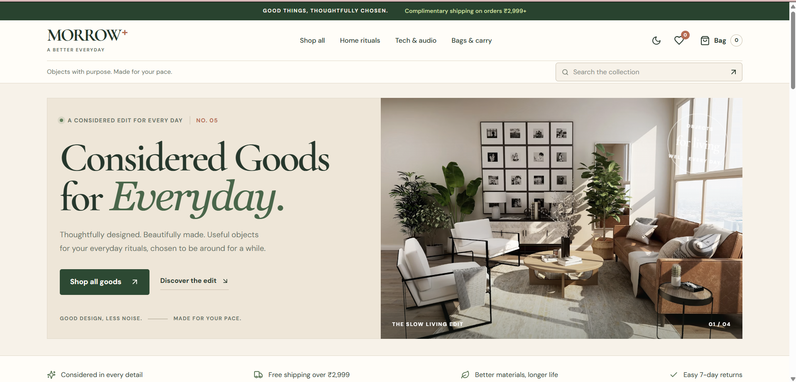

# MORROW+ — E-Commerce Website

**Considered goods for everyday.**

MORROW+ is a modern, responsive e-commerce website designed and developed by **Divya** using React and Vite. It provides an intuitive online shopping experience with a curated product catalogue, product detail pages, shopping cart management, wishlist functionality, promotional discounts, and light and dark themes.

## Live Demo

**Explore the website:** [MORROW+ — Live Website](https://morrow-ecommerce.vercel.app/)

**GitHub Repository:** [divya-code-tech/morrow-ecommerce](https://github.com/divya-code-tech/morrow-ecommerce)

---

## Homepage Preview



*The homepage screenshot is stored at `screenshots/01-homepage.png` in the repository.*

---

## Table of Contents

- [Overview](#overview)
- [Features](#features)
- [Technology Stack](#technology-stack)
- [Project Structure](#project-structure)
- [Getting Started](#getting-started)
- [Demo Coupon](#demo-coupon)
- [Testing and Verification](#testing-and-verification)
- [Screenshots](#screenshots)
- [Known Limitations](#known-limitations)
- [Future Improvements](#future-improvements)
- [Author](#author)
- [Conclusion](#conclusion)

---

## Overview

MORROW+ is a frontend e-commerce application focused on clean visual design, responsive layouts, and interactive shopping functionality.

Users can browse products, search the catalogue, apply category filters, sort products by price, view product details, manage a shopping cart, save favourite products, and apply promotional discounts.

The catalogue contains **17 demo products** across five categories:

- Tech
- Wear
- Home
- Carry
- Desk

The application uses React for its component-based interface and Redux Toolkit for application state management. It also provides browser-side persistence for supported features.

## Features

### 1. Homepage and Product Catalogue

- MORROW+ branded homepage with a hero banner.
- Product cards featuring images, prices, ratings, and product information.
- Search functionality.
- Category-based filtering.
- Price sorting from low to high.
- Pagination for browsing the product catalogue.

### 2. Product Details

- Individual product detail pages.
- Product image gallery and thumbnails.
- Product names, descriptions, categories, and prices.
- Default colour display for each product.
- Quantity selection.
- Add-to-cart functionality.
- Wishlist controls.
- Related product recommendations.

### 3. Shopping Cart

- Add products to the cart.
- Increase and decrease product quantities.
- Remove individual products or clear the cart.
- Automatic subtotal and order total calculations.
- Shipping cost and free-shipping eligibility display.
- Promotional discount application.
- Cart persistence across browser refreshes.

### 4. Promotional Discounts

The cart supports the demo coupon code `MORROW10`.

- Applies a 10% discount to the cart subtotal.
- Displays the discount and recalculated total.
- Preserves the applied coupon across browser refreshes.
- Supports coupon removal and preserves the removal after refresh.

### 5. Wishlist

- Add products to the wishlist.
- View saved products.
- Remove products from the wishlist.
- Preserve wishlist selections across browser refreshes.

### 6. Light and Dark Themes

- Toggle between light and dark modes.
- Maintain readable interface elements in both themes.
- Preserve the selected theme across browser refreshes.

### 7. Responsive Design

- Responsive layouts for desktop, tablet, and mobile screens.
- Mobile layout tested at a viewport width of 375 px.
- Tablet layout tested at a viewport width of 768 px.

---

## Technology Stack

| Technology | Purpose |
|---|---|
| React | Component-based user interface |
| Vite | Development server and production build tooling |
| React Router | Client-side navigation |
| Redux Toolkit | Application state management |
| React Redux | Connecting React components to Redux |
| Lucide React | Interface icons |
| CSS | Styling and responsive layouts |
| JavaScript | Application logic |
| localStorage | Browser-side persistence for supported application state |
| Git and GitHub | Version control and source-code hosting |
| Vercel | Website deployment and hosting |

---

## Project Structure

The following is a simplified overview of the project structure.

```text
MORROW/
├── public/
├── screenshots/
│   ├── 01-homepage.png
│   ├── 02-shop-catalogue.png
│   └── ...
├── src/
│   ├── app/
│   ├── components/
│   ├── data/
│   │   └── products.js
│   ├── features/
│   │   ├── cart/
│   │   ├── products/
│   │   ├── ui/
│   │   └── wishlist/
│   ├── pages/
│   │   ├── CartPage.jsx
│   │   └── ProductPage.jsx
│   ├── services/
│   │   └── productService.js
│   └── ...
├── index.html
├── package.json
├── package-lock.json
├── vite.config.js
└── README.md
```

*This is a simplified overview. The actual project may contain additional files and directories.*

---

## Getting Started

### Prerequisites

Install the following:

- [Node.js](https://nodejs.org/)
- npm
- Visual Studio Code or another code editor
- A modern web browser

### 1. Clone the Repository

```bash
git clone https://github.com/divya-code-tech/morrow-ecommerce.git
cd morrow-ecommerce
```

### 2. Install Dependencies

```bash
npm install
```

### 3. Start the Development Server

```bash
npm run dev
```

Open the local URL displayed in the terminal. With the default Vite configuration, it is usually:

```text
http://localhost:5173/
```

### 4. Create a Production Build

```bash
npm run build
```

### 5. Preview the Production Build

```bash
npm run preview
```

Open the preview URL displayed in the terminal.

---

## Demo Coupon

Use this code on the shopping cart page:

`MORROW10`

The coupon applies a 10% discount to the cart subtotal.

### Example Calculation

| Item | Amount |
|---|---:|
| Subtotal | ₹7,780 |
| Discount — 10% | −₹778 |
| Shipping | Complimentary |
| **Final Total** | **₹7,002** |

This example assumes the order qualifies for free shipping under the application's shipping rules.

**Note:** MORROW+ uses a demonstration checkout flow. No real payments are collected.

---

## Testing and Verification

The following results have been reported from manual browser testing.

| Test Case | Result |
|---|---|
| Product listing | PASS |
| Product search | PASS |
| Category filtering | PASS |
| Price sorting | PASS |
| Pagination | PASS |
| Add products to cart | PASS |
| Quantity updates | PASS |
| Product removal and empty-cart state | PASS |
| Subtotal and coupon calculations | PASS |
| Cart persistence after refresh | PASS |
| Coupon persistence and removal | PASS |
| Wishlist functionality and persistence | PASS |
| Light and dark theme switching | PASS |
| Theme persistence after refresh | PASS |
| Mobile responsiveness at 375 px | PASS |
| Tablet responsiveness at 768 px | PASS |
| Production build using `npm run build` | PASS |
| Production preview | PASS |

These results are based on manual testing and the reported outcomes of the application.

---

## Screenshots

Twelve screenshots have been captured to demonstrate the interface and key functionality:

1. Homepage
2. Shop catalogue
3. Search results
4. Product details
5. Shopping cart with coupon applied
6. Wishlist
7. Dark mode
8. Mobile view
9. Category filtering
10. Pagination
11. Empty cart
12. Tablet view

The screenshots are available in the repository's `screenshots` directory and the accompanying project evidence document.

The homepage screenshot is embedded at the beginning of this README. To display correctly on GitHub, the image must exist at:

```text
screenshots/01-homepage.png
```

---

## Known Limitations

- Each product currently has one default colour. Multiple selectable colour variants are not configured unless explicitly defined in the product data.
- Product catalogue information is supplied by the local product data service.
- Checkout is a demonstration flow and does not process real payments.
- Cart, coupon, wishlist, and theme persistence use browser-side storage rather than account-based cloud synchronisation.
- The application focuses on frontend functionality and is not a complete production-ready e-commerce platform.

## Future Improvements

Potential enhancements include:

- Multiple product colour variants with corresponding images.
- Preserving selected product variants in the shopping cart.
- User authentication and account management.
- Backend integration for products and orders.
- Server-side coupon validation.
- Payment gateway integration.
- Automated unit and end-to-end testing.

---

## Author

**Divya**

Designed and developed by Divya.

- **GitHub:** [divya-code-tech](https://github.com/divya-code-tech)
- **Project Repository:** [morrow-ecommerce](https://github.com/divya-code-tech/morrow-ecommerce)
- **Live Website:** [morrow-ecommerce.vercel.app](https://morrow-ecommerce.vercel.app/)

---

## Conclusion

MORROW+ combines modern interface design with essential e-commerce functionality in a responsive web application. It demonstrates product discovery, shopping cart management, promotional discounts, wishlist functionality, browser-side persistence, theme switching, and responsive layouts.

The project has been manually tested against its main shopping workflows, checked at mobile and tablet viewport widths, and successfully compiled for production.

**MORROW+ — Considered goods for everyday.**
